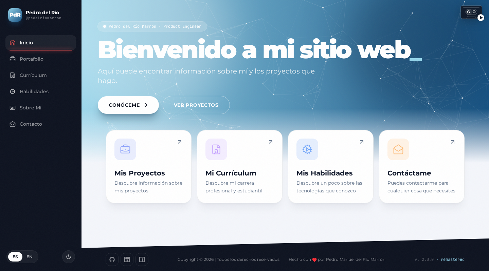

# Pedro del Río Marrón · Web

Mi web personal, creada en 2020 con React 16 y Tailwind 1, y **remasterizada en 2026**: la misma esencia (barra lateral con un color por sección, hero con partículas, cabeceras de color, footer inclinado, ES/EN) con React 19, Vite, Tailwind 4, modo oscuro y un casete que suena.



🌐 https://pedelriomarron.github.io/web/

## Desarrollo

```bash
npm install
npm run dev      # servidor local en http://localhost:5173
npm run build    # compilación de producción en dist/
npm run deploy   # compila y publica en GitHub Pages (rama gh-pages)
```

- Los datos del currículum y las habilidades están en `src/data.ts`; el archivo de proyectos, en `src/archive.ts`.
- El CV descargable es `public/cv/CV-Pedro-del-Rio-Marron.pdf`, generado a partir de `cv/cv.html`.
- El casete reproduce `public/music/smooth-criminal.mp3` si existe; si no, una base sintetizada propia.
